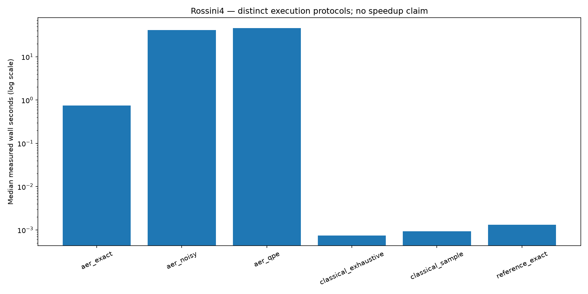

# Measured benchmark report — 8 November 2026

738 matrix records plus 20 isolated five-gene MPS runs: **758 attempts**, of which
**738 completed** and **20 were rejected before execution by the memory guard**.
The rejected configurations are 25-qubit five-gene statevector runs, requiring
512 MiB amplitudes plus the configured 3x working allowance, exceeding 1024 MiB.
These are resource rejections, not successful circuit measurements.

## Rossini four-gene results

| Protocol | Repeats | Median seconds | IQR seconds | Mean attractor recall |
|---|---:|---:|---:|---:|
| aer_exact | 20 | 0.74902 | 0.512317–0.801177 | 1.000 |
| aer_noisy | 3 | 41.2654 | 37.2977–41.6217 | 1.000 |
| aer_qpe | 3 | 45.8387 | 45.7925–45.9819 | 1.000 |
| classical_exhaustive | 20 | 0.0007484 | 0.000724425–0.00079275 | 1.000 |
| classical_sample | 20 | 0.00093725 | 0.000824175–0.00099455 | 1.000 |
| reference_exact | 20 | 0.00131915 | 0.00128085–0.0013536 | 1.000 |

QPE uses 3 precision bits, 128 counting shots, and 128 search shots. All three
QPE runs reported heuristic completion and were independently scored at full recall.
This does not validate the heuristic for unseen networks or prove completeness.
Noisy runs use depolarizing error 0.002 on one- and two-qubit gates, not a real
device calibration. Exact-M Aer uses classical enumeration for M and classical
coverage certification; its timing is not a quantum-only solution.

## Five-gene MPS

20 isolated runs, T=4, 25 logical qubits, 128 shots. Every run found both
attractors and obtained independent classical coverage certification. Median
solver time 2.34978 s; median isolated wall time
3.00389 s including process startup.

## Larger models and methodology

Projection, skewed, cycle2 and long_chain families were exercised at 4, 10 and 15
nodes. The small families have 20 repetitions. Fifteen-node reference runs use
3 repeats due their enumeration cost; QPE/noise also use 3 due circuit cost.
10/15-node full circuits are resource estimates only in this matrix. In particular
the 15-node long chain requires 225 logical evolution qubits.

The classical_sample protocol draws min(128,2^n) unique states; for 4/5 nodes this
happens to cover the full state space and is not evidence of sparse-sampling ability.
Independent exhaustive truth timings are separate. Raw measurements, timing,
rejected outcomes, seeds, circuit depth, two-qubit counts and completion flags are
in benchmark-current/raw.csv and raw.jsonl. Seed-zero full quantum histories and
all five-gene MPS histories are retained. Per-process peak memory in the main
matrix is a lifetime high-water mark, not isolated incremental memory per run.
Compilation/transpilation records are in circuit execution history where retained.
Queue time and physical execution time are unavailable: no QPU was used.

IQR is empirical variability, not a confidence interval. With all 20 repeated
runs successful, a binomial Wilson 95% interval for run-success probability is
approximately [0.839,1]; with only 3 it is [0.438,1]. These intervals describe this
fixed protocol under independent trials, not completeness guarantees or biological
generalization. Small-n classical enumeration is much faster here; no quantum
speedup is established.

## Reproduce

```powershell
python tools/benchmark_integrated.py --output validation/new-matrix
python tools/benchmark_five_mps.py
python tools/demo_integrated.py
```

The MPS/demo scripts overwrite their named result JSONs on rerun and append new
durable job records. Preserve original outputs when comparing experiments.


